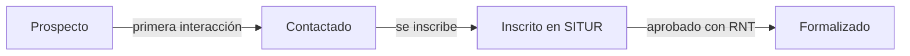

# Prestadores y seguimiento

## Lista de prestadores

Busca por nombre, documento, correo, nombre de establecimiento o RNT, y filtra por estado, etapa, categoría,
responsable o etiqueta. **Los filtros quedan en la dirección de la página**: puedes copiarla y compartir la vista con
un compañero.

Con **Nuevo prestador** registras a alguien que conociste en una visita, un evento o por referido. Queda en la etapa
**Prospecto** hasta que se inscriba.

**Exportar CSV** descarga la lista completa (se abre bien en Excel en español).

## Ficha del prestador

La ficha reúne todo sobre el prestador:

| Pestaña | Contenido |
|---|---|
| **Resumen** | Datos del titular, cuentas de acceso y el panel **Gestión**: etapa, responsable, etiquetas y notas internas. |
| **Establecimientos** | Sus sedes, con estado, RNT y número de fotos. |
| **Seguimiento** | Historial de llamadas, visitas, mensajes y capacitaciones, más el formulario para registrar una nueva. |
| **Contactos** | Personas de contacto; la principal lleva una estrella. Celular con enlace directo a WhatsApp. |
| **Tareas** | Pendientes asociados a este prestador. |
| **Documentos** | RUT, cámara de comercio, RNT… |
| **Empleo y finanzas** | Datos por año, para comparar su evolución. |

:::note[Notas internas]
Las notas, la etapa, el responsable y las etiquetas **solo las ve el equipo**; el prestador no tiene acceso.
:::

## Etapas

Algunas transiciones son automáticas (marcadas en el diagrama); siempre puedes ajustar la etapa a mano en **Gestión**.

## Registrar una interacción

En **Seguimiento**, elige el tipo (llamada, visita, correo, WhatsApp, reunión, capacitación, evento o nota), escribe
el asunto y, si quieres, el detalle, el resultado, con quién hablaste y sobre qué establecimiento.

Activa **Mostrar cambios de datos** para ver también la bitácora: quién cambió qué y cuándo.

La pantalla **Seguimiento** del menú muestra las interacciones de **todo el equipo**, filtrables por tipo, persona y fechas.
