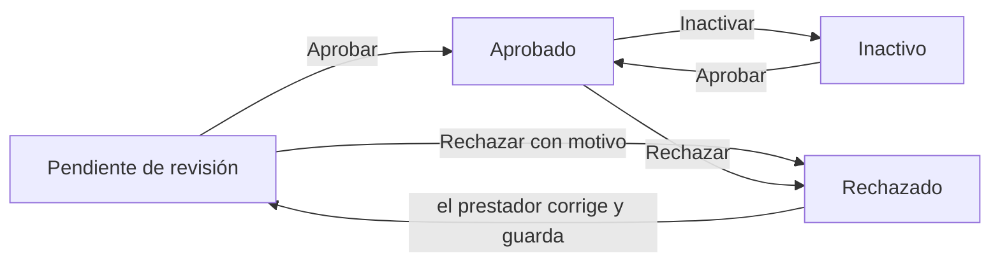

# Revisar inscripciones

Cada inscripción del formulario llega al CRM como una **empresa** (el titular), un **contacto** (la persona de
contacto) y uno o varios **establecimientos**, asociados entre sí. Lo que se revisa es **cada establecimiento**.

## Encontrar lo pendiente

En **Establecimientos**, filtra por estado **Pendiente de revisión** y ordena por fecha de creación. Ahí quedan:

1. los establecimientos de inscripciones nuevas,
2. los establecimientos nuevos que un prestador agregó con su enlace,
3. los que fueron rechazados y el prestador ya corrigió (vuelven solos a pendiente).

El filtro **Rechazado** muestra los que esperan corrección del prestador, con su motivo en la ficha.

## Aprobar o rechazar

:::info[Solo administradores]
Cambiar el estado de revisión es exclusivo de los roles **Superadministrador** y **Administrador**; lo exige la base de
datos. Los demás ven el estado y el motivo de un rechazo, pero no pueden cambiarlo.
:::

En la ficha del establecimiento, bajo el nombre, está la tarjeta **Revisión pendiente** (o **Estado**):

- **Aprobar**: el establecimiento pasa a **Aprobado**.
- **Rechazar**: pide el **motivo**, que verá el prestador en el correo y en el formulario. Sé específico: qué falta y
  cómo corregirlo.
- **Inactivar**: para un establecimiento aprobado que dejó de operar. Se puede volver a aprobar.

En un establecimiento rechazado, todo el equipo ve el motivo en la tarjeta **Estado**:

La casilla **Avisar al prestador por correo** viene marcada. Al aprobar o rechazar, el CRM envía a cada contacto del
establecimiento el resultado (y el motivo, si es un rechazo) junto con su **enlace de 7 días** para actualizar la
inscripción. El correo queda en la cronología del establecimiento. Si el envío falla, el cambio de estado se conserva
y el CRM avisa del error.

## Qué revisar

- Que la **categoría** y el **tipo** correspondan a lo que ofrece.
- El **RNT** y los documentos adjuntos (en sus campos de archivos y en la caja **Archivos adjuntos**).
- Las **coordenadas**: el enlace junto a ellas abre Google Maps. La latitud de Tenjo está cerca de 4,87 y la longitud
  cerca de -74,14.
- Las fotos y la descripción, que es lo que verán los visitantes.

Cada revisión queda en la pestaña **Historial** del establecimiento, con quién la hizo y cuándo.
