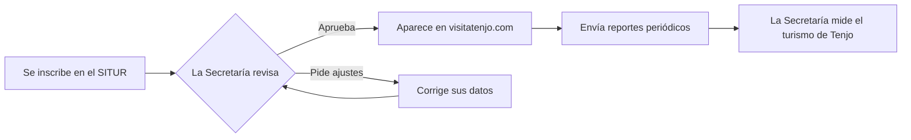

# ¿Qué es el SITUR?

El **SITUR** (Sistema de Información Turística de Tenjo) es la herramienta con la que la **Secretaría de Desarrollo
Económico y Turismo** de Tenjo:

- conoce a los **prestadores turísticos** del municipio (fincas, cafés, restaurantes, guías, agencias, parques…),
- acompaña su **formalización** (Registro Nacional de Turismo),
- recibe sus **reportes periódicos** (visitantes, ocupación, tarifas…) para medir el turismo en Tenjo,
- y publica su oferta aprobada en **[visitatenjo.com](https://visitatenjo.com)**.

## ¿Quién lo usa?

| Persona | Qué hace en el SITUR | Guía |
|---|---|---|
| **Prestador turístico** | Se inscribe, mantiene sus datos y fotos al día y envía reportes. | [Inscripción](/prestadores/inscripcion) |
| **Gestor de la Secretaría** | Hace seguimiento a los prestadores: llamadas, visitas, tareas y reportes. | [Equipo](/equipo/inicio-y-revisiones) |
| **Administrador** | Además aprueba inscripciones, publica en la web y configura el sistema. | [Administración](/administracion/configuracion) |
| **Desarrollador** | Instala, mantiene y despliega el sistema. | [Documentación técnica](/tecnico/arquitectura) |

## El recorrido de un prestador

## Palabras que vas a encontrar

| Término | Qué significa |
|---|---|
| **Prestador** | La persona o empresa titular del negocio turístico. Puede tener varios establecimientos. |
| **Establecimiento** | Cada sede o servicio: un hostal, un café, un recorrido guiado. Es lo que se publica en la web. |
| **RNT** | Registro Nacional de Turismo, obligatorio para la mayoría de prestadores en Colombia. |
| **Categoría** | El tipo de prestador según el RNT (alojamiento, restaurantes, agencias…). Define qué preguntas y reportes aplican. |
| **Tipo de turismo** | La experiencia que ofrece (senderismo, gastronómico, bodas…). Organiza las secciones de visitatenjo.com. |
| **Reporte** | Las cifras que el establecimiento envía cada mes, trimestre, semestre o año. |
| **Etapa** | En qué punto de la relación está el prestador: prospecto, contactado, inscrito o formalizado. |

:::info[¿Vienes del SITUR anterior?]
Si ya estabas inscrito, tus datos, fotos y establecimientos se trasladaron al nuevo sistema y **tu contraseña sigue
siendo la misma**. Si no la recuerdas, usa «Olvidé mi contraseña» en la pantalla de ingreso.
:::
