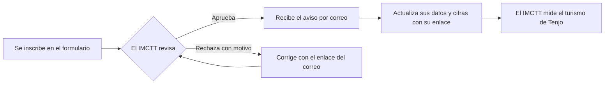

# ¿Qué es el SITUR?

El **SITUR** (Sistema de Información Turística de Tenjo) es la herramienta con la que el **Instituto Municipal de
Cultura y Turismo de Tenjo (IMCTT)**:

- conoce a los **prestadores turísticos** del municipio (fincas, cafés, restaurantes, guías, agencias, parques…),
- revisa y aprueba sus **establecimientos**,
- recibe sus **reportes periódicos** (visitantes, ocupación, tarifas…) para medir el turismo en Tenjo,
- les envía **encuestas**,
- y alimenta la oferta de **[visitatenjo.com](https://visitatenjo.com)**.

Desde noviembre de 2026 el SITUR funciona dentro del **CRM Turismo Tenjo**: el equipo del IMCTT trabaja en el CRM y
los prestadores usan un **formulario público** de inscripción, sin necesidad de crear una cuenta.

## ¿Quién lo usa?

| Persona | Qué hace | Guía |
|---|---|---|
| **Prestador turístico** | Se inscribe en el formulario, actualiza sus datos con el enlace que le llega al correo y reporta sus cifras. | [Inscripción](/prestadores/inscripcion) |
| **Equipo del IMCTT** | Revisa establecimientos, hace seguimiento a cada prestador, gestiona tareas, reportes y encuestas. | [Equipo](/equipo/primeros-pasos) |
| **Administrador** | Además aprueba o rechaza establecimientos, configura las preguntas e invita al equipo. | [Administración](/administracion/configuracion) |
| **Desarrollador** | Instala, mantiene y despliega el sistema. | [Documentación técnica](/tecnico/arquitectura) |

## El recorrido de un prestador

## Palabras que vas a encontrar

| Término | Qué significa |
|---|---|
| **Empresa** | El titular del negocio turístico: una persona natural (por cédula) o jurídica (por NIT). Puede tener varios establecimientos. |
| **Contacto** | La persona con la que habla el IMCTT y a cuyo correo llegan los avisos. |
| **Establecimiento** | Cada sede o servicio: un hostal, un café, un recorrido guiado. |
| **Estado de revisión** | Pendiente de revisión, aprobado, rechazado (con motivo) o inactivo. |
| **RNT** | Registro Nacional de Turismo, obligatorio para la mayoría de prestadores en Colombia. |
| **Categoría** | El tipo de prestador (alojamiento, restaurantes, agencias…), con sus subcategorías. Define qué preguntas e indicadores aplican. |
| **Indicador** | Una cifra periódica que reporta el establecimiento (mensual, trimestral, semestral o anual). |
| **Reporte estadístico** | Los indicadores de un establecimiento para un periodo, por ejemplo «Finca El Mirador · Octubre 2026». |
| **Encuesta** | Un cuestionario con enlace público que el IMCTT envía a prestadores o visitantes. |

:::info[¿Vienes del SITUR anterior?]
Si ya estabas inscrito, tus datos, fotos, documentos y reportes se trasladaron al nuevo sistema. **Ya no hay
contraseña**: entra con [«Actualizar mi inscripción»](/prestadores/actualizar) y el correo con el que te inscribiste.
:::
