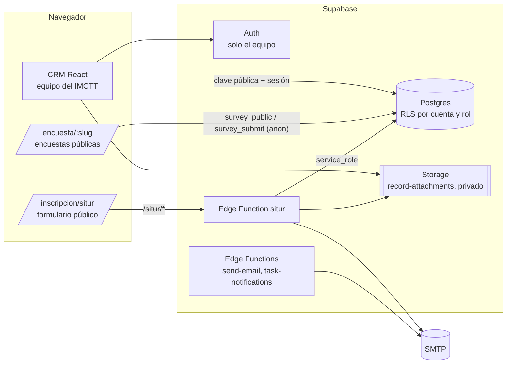
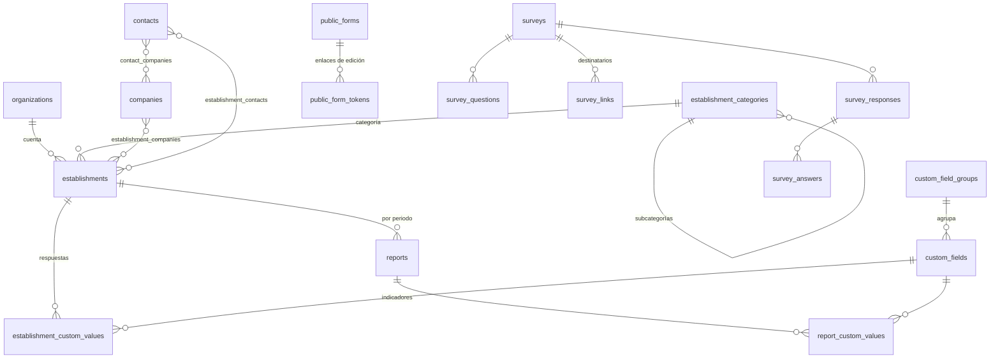

# Arquitectura

Desde noviembre de 2026 el SITUR funciona dentro del **CRM de Oblicua** (repositorio `oblicuaDev/imctt-crm`), con la
marca del IMCTT y tres **módulos opcionales** activados para la cuenta: establecimientos, reportes estadísticos y
encuestas. La aplicación anterior (`crm-tenjo/`, Laravel 12 + MySQL) y el SITUR original (`situr/` + `api-situr/`)
quedan **retirados**.



| Parte | Tecnología | Dónde |
|---|---|---|
| Frontend | React 19, TypeScript, Vite 8, React Router 7, Tailwind CSS 4, Recharts | `src/` |
| Base de datos, autenticación y archivos | Supabase: Postgres, Auth, Storage | `supabase/migrations/` |
| Lógica de servidor | Supabase Edge Functions (Deno) | `supabase/functions/` |
| Marca del IMCTT | `brands/imctt/` (se compila con `BRAND=imctt`) | `brands/imctt/` |
| Hosting del frontend | Archivos estáticos en cPanel, subidos por GitHub Actions | `.github/workflows/deploy.yml` |
| Documentación | Docusaurus 3 | `tenjo-docs/` (este sitio) |

No hay servidor propio: el navegador consulta Supabase con la clave pública y **la RLS es la autorización efectiva**.
Las reglas que siempre deben cumplirse (validaciones, permisos, quién cambia el estado de revisión) viven en Postgres
como *checks*, *triggers* y políticas.

## Principio: la personalización vive en los datos

El CRM es **multicuenta**. Todo lo específico del IMCTT es **una fila de la base**, no código:

- las categorías y subcategorías (`establishment_categories`),
- las preguntas de empresas y establecimientos y los indicadores (`custom_fields`, con su `external_key`),
- los grupos de preguntas por categoría y frecuencia (`custom_field_groups.category_ids`, `frequency`),
- el formulario público, sus textos y reglas (`public_forms.settings`),
- los módulos activos (`organizations.modules`: `establishments`, `reports`, `surveys`).

Por eso el formulario público no tiene ids escritos en el código, a diferencia del SITUR anterior: si el IMCTT cambia
una pregunta en Configuración, el formulario la muestra así sin desplegar nada.

## Modelo de datos (módulos del SITUR)



- **Empresa** (`companies`): el titular. El formulario la identifica por NIT o cédula (campos personalizados).
- **Contacto** (`contacts`): la persona de contacto, identificada por correo. Recibe los avisos y los enlaces.
- **Establecimiento** (`establishments`): nombre, categoría, subcategoría, dirección, coordenadas, teléfono, correo,
  web, responsable y **estado de revisión** (`pending`, `approved`, `rejected` con `status_reason`, `inactive`). Un
  trigger (`protect_establishment_status`) solo deja cambiar el estado a administradores.
- **Reporte** (`reports`): uno por establecimiento, frecuencia y periodo (`period_start` es el primer día del
  periodo). Los indicadores son campos personalizados del objeto `report`. Borrador → enviado; `submitted_at` y
  `submitted_by` los pone la base.
- **Historial** (`record_changes`): cada cambio de una columna o de un campo personalizado, con antes, después,
  quién y cuándo. Lo escriben triggers; el cliente solo lee.
- **Cronología** (`activities`): notas, llamadas, reuniones, WhatsApp, correos de revisión, asociaciones y adjuntos.
- **Adjuntos** (`attachments` + bucket privado `record-attachments`): fotos y documentos, en
  `<organization_id>/<objeto>/<registro>/`, servidos con URLs firmadas.

## Piezas del SITUR en el código

| Pieza | Dónde |
|---|---|
| Establecimientos y reportes | `supabase/migrations/20261201090000_establishments_reports.sql`, `src/pages/Establishments.tsx`, `src/pages/StatisticalReports.tsx`, `src/components/establishments/`, `src/lib/establishmentRepository.ts` |
| Historial y selección múltiple | `20261202090000_change_history_multiselect.sql`, `src/components/record/RecordHistory.tsx` |
| Formulario público | `20261203090000_public_form_intake.sql`, `20261205090000_public_form_schema.sql`, `supabase/functions/situr/`, `supabase/functions/_shared/publicForm.ts`, `src/pages/PublicRegistration.tsx`, `src/components/registration/` |
| Encuestas | `20261204090000_surveys.sql`, `src/pages/surveys/`, `src/components/surveys/`, `src/pages/PublicSurvey.tsx` |
| Catálogo e histórico | `scripts/imctt/` |
| Marca | `brands/imctt/` |

Las reglas de validación del formulario (`publicForm.ts`) se comparten entre el navegador y la Edge Function, para que
un dato nunca se valide distinto en un lado y en el otro.

## Pruebas

```bash
npm test          # pruebas unitarias (incluye test:situr, test:surveys y test:email)
npm run test:db   # pruebas SQL de supabase/tests/ contra una base local (supabase start)
```

Las del SITUR: `tests/public-form.test.ts`, `tests/situr-translate.test.ts`, `tests/situr-history.test.ts`,
`tests/survey-logic.test.ts` y, en SQL, `supabase/tests/establishments_reports.sql`,
`change_history_multiselect.sql`, `public_form_intake.sql`, `public_form_schema.sql` y `surveys.sql`. GitHub Actions
(`ci.yml`) corre ambas en `a-dev`, `main` y los pull requests.
