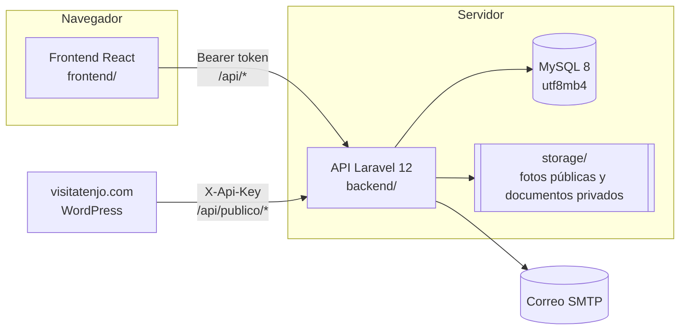
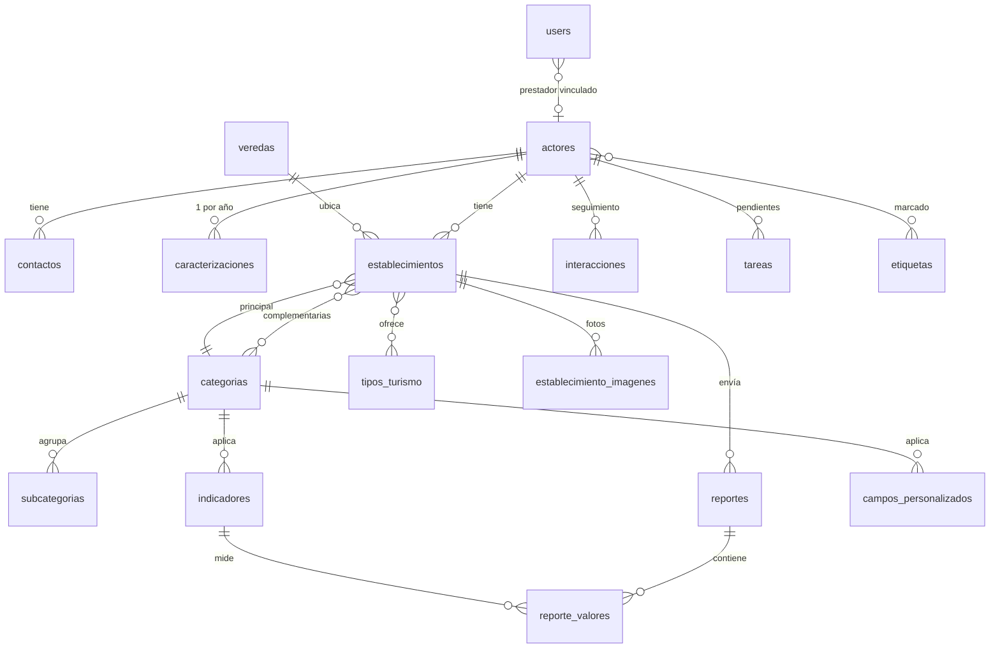

# Arquitectura

El código vive en `crm-tenjo/` y tiene dos aplicaciones independientes que se comunican por una API REST.



| Parte | Tecnología | Carpeta |
|---|---|---|
| API | Laravel 12, PHP 8.2, Sanctum (tokens), MySQL 8 | `backend/` |
| Frontend | React 19, Vite 6, TypeScript, Tailwind 4, TanStack Query, Leaflet, Recharts | `frontend/` |
| Entorno local | Docker Compose (MySQL, phpMyAdmin, Mailpit, API) o XAMPP | `docker-compose.yml` |
| Documentación | Docusaurus 3 | `tenjo-docs/` |

## Modelo de datos



- **Actor**: el titular. Único por tipo y número de documento.
- **Estado** (`pendiente`, `aprobado`, `rechazado`, `inactivo`): revisión SITUR. Solo lo cambia `RevisionService`.
- **Etapa** (`prospecto` → `contactado` → `inscrito` → `formalizado`): relación CRM.
- **Campos personalizados**: preguntas de perfil por categoría. Las respuestas van en `establecimientos.datos_extra`
  (JSON) y se **validan en el servidor** contra la definición; las claves desconocidas se descartan.
- **Indicadores / reportes**: una fila por establecimiento, frecuencia y periodo (`2026-09`, `2026-Q3`, `2026-S1`,
  `2026`), con un valor por indicador.
- **Actividades**: bitácora automática (trait `RegistraActividad`) con el antes y el después de cada cambio.

## Backend

```
backend/app/
├── Console/Commands/ImportarSitur.php   migración desde el SITUR anterior
├── Enums/                               estados, etapas, roles, frecuencias…
├── Http/Controllers/                    un controlador por recurso
├── Http/Middleware/                     rol:… y llave de la API pública
├── Models/                              Eloquent (tablas en español, $table explícito)
├── Notifications/                       correos
├── Policies/                            quién puede ver/editar cada actor y establecimiento
├── Services/                            Registro, Establecimiento, Revision, Reporte
└── Support/                             Reglas de validación compartidas, campos personalizados, normalizadores
```

Principios:

1. **Una operación, una transacción.** La inscripción pública crea usuario, actor, contacto, caracterización y
   establecimientos en una sola llamada (`POST /api/registro`).
2. **Validación solo en el servidor**, con reglas compartidas (`Support/Reglas.php`) entre la inscripción y el CRM.
3. **Autorización en dos capas**: middleware `rol:` por grupo de rutas y *policies* por registro.
4. **Los correos nunca rompen la operación** (`Support/Notificar.php`): si falla el SMTP se registra en el log.
5. **Enums servidos al frontend** por `/api/meta`: las etiquetas no se duplican.

## Frontend

```
frontend/src/
├── components/   ui.tsx (kit), formularios.tsx (titular, establecimiento, caracterización), Compartidos.tsx
├── lib/          api.ts (cliente HTTP), auth.tsx, meta.ts, format.ts, types.ts
└── pages/
    ├── publico/  ingreso, recuperación y asistente de inscripción
    ├── portal/   cuenta del prestador
    └── crm/      pantallas del equipo
```

Los formularios de titular y establecimiento son **los mismos componentes** en la inscripción, el portal y el CRM,
para que un campo nunca se comporte distinto según dónde se edite. Los errores 422 de Laravel se muestran junto a
cada campo.

## Pruebas

```powershell
cd backend
C:\xampp\php\php.exe artisan test     # 58 pruebas
```

Cubren seguridad (accesos por rol y por dueño), inscripción atómica, revisión y publicación, reportes, CRM, la
importación desde SITUR con la forma real de sus datos y los normalizadores (veredas, coordenadas, números).
