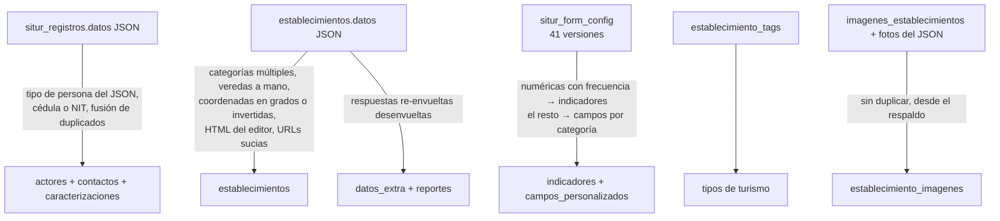

# Migración desde el SITUR anterior

El comando `situr:importar` lleva al CRM los datos del SITUR anterior (`situr/` + `api-situr/`). Se probó con el
**dump real de producción** del 22/10/2026 y el respaldo de `/uploads` (707 MB).

## Pasos

1. **Exportar** desde el cPanel la base `situr_db_tenjo` (phpMyAdmin → Exportar) y la carpeta `uploads/` de
   `api-situr` como `uploads.zip`.
2. **Cargar** el dump en el MySQL de Docker:
   ```powershell
   cmd /c "docker compose exec -T mysql mysql -uroot -proot_local situr_db_tenjo < ..\situr_db_tenjo.sql"
   ```
3. **Descomprimir** `uploads.zip` en `backend/storage/app/situr/` (queda `storage/app/situr/uploads/…`).
4. **Simular** y revisar los avisos:
   ```powershell
   docker compose exec api php artisan situr:importar --simular --uploads=storage/app/situr/uploads --excluir="test@test.com,proyectos@oblicua.co"
   ```
5. **Importar**: el mismo comando sin `--simular`. Es **idempotente** (usa `legacy_id`), así que el día del cambio se
   puede repetir para traer lo que se haya inscrito entretanto.

| Opción | Uso |
|---|---|
| `--simular` | Ejecuta todo en una transacción y la revierte. |
| `--uploads=` | Carpeta con el respaldo de `/uploads`. |
| `--descargar-imagenes` | Si un archivo no está en `--uploads`, lo descarga del servidor de SITUR. |
| `--excluir=` | Correos (separados por coma) cuyas cuentas y registros no se importan. |

## Resultado con los datos de producción

| | |
|---|---|
| Usuarios (con su misma contraseña) | 70 |
| Prestadores (2 duplicados fusionados) | 75 |
| Establecimientos | 77 |
| Fotos | 358 |
| Reportes | 61 |
| Indicadores y campos creados desde el formulario | 47 y 28 |

## Qué corrige el importador



- **Contraseñas**: se conservan los hash bcrypt. La clave `password` que SITUR guardaba **en texto plano** dentro del
  JSON de registros **nunca se lee**.
- **Coordenadas**: acepta `4°52′11″N`, `4.8875 Norte`, longitudes sin signo e invertidas; descarta las imposibles
  con una nota en el prestador.
- **Veredas**: reconoce `VRDA POVEDA 2`, `Centro`, `Guanguatá`, `Churuguaco Bajo`…
- **Categorías y subcategorías** desconocidas se crean (y se avisan); el texto libre se normaliza.
- **Registros del equipo**: los que hizo la cuenta de la Secretaría quedan sin cuenta de prestador.
- **Posibles pruebas**: lista los registros con nombres como «Prueba» o «test 1» para decidir si excluirlos.
- **Imágenes huérfanas** (508 de establecimientos ya borrados) y las que dan 404 se omiten.
