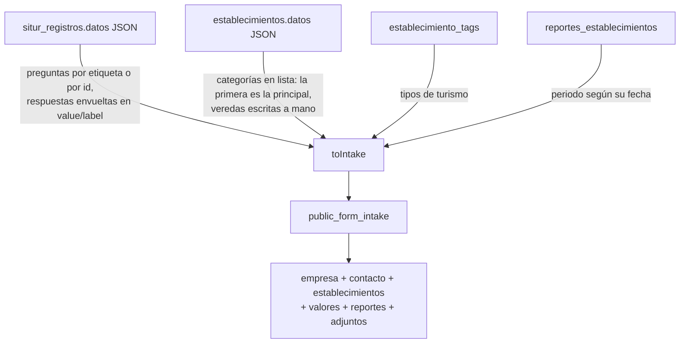

# Migración desde el SITUR anterior

`scripts/imctt/import-situr-history.mjs` lee el volcado MySQL del SITUR anterior (`situr_db_tenjo.sql`) y genera un
SQL que pasa cada registro por **la misma traducción del formulario público** (`toIntake` → `public_form_intake`). Así,
lo histórico queda igual que una inscripción nueva.

:::note[Sustituye al importador de crm-tenjo]
El comando `php artisan situr:importar` de `crm-tenjo` ya no se usa. El nuevo importador no crea cuentas de prestador:
en el CRM no existen.
:::

## Pasos

```bash
# 1. Generar el SQL. «uploads» es la carpeta del zip del hosting del SITUR (fotos y documentos).
SUPABASE_URL=https://<proyecto>.supabase.co SUPABASE_SERVICE_ROLE_KEY=<clave> \
node scripts/imctt/import-situr-history.mjs --dump situr_db_tenjo.sql \
  --exclude test@test.com,proyectos@oblicua.co --uploads uploads > historico.sql

# 2. Cargar los datos (una sola transacción: si algo falla, no queda nada a medias).
supabase db query --linked --file historico.sql      # o: psql <conexión> -f historico.sql
```

- Con `--uploads`, el script **sube primero los archivos** al bucket `record-attachments`, en
  `<cuenta>/establishment/situr-<id del SITUR>/`. Volver a subir reemplaza el mismo archivo. Sin `--uploads`, el SQL no
  incluye adjuntos.
- `--exclude` recibe los correos de las cuentas de prueba del SITUR; sus registros no se importan.
- El resumen y los avisos salen por la consola sin interrumpir la importación: establecimientos sin categoría (quedan
  en «Otros»), archivos que el SITUR nunca guardó o que no vienen en el zip, y casos parecidos.

:::tip[Repetirlo es seguro]
Cada establecimiento guarda su id del SITUR en el campo «ID en el SITUR anterior» (`external_key = situr_id`) y no se
importa dos veces. El día del cambio se puede volver a correr para traer lo que se haya inscrito entretanto.
:::

## Qué conserva

- El **estado de revisión**: aprobado, pendiente o rechazado. Si el SITUR no guardó el motivo del rechazo, queda «sin
  motivo registrado».
- Las **fechas originales** del establecimiento, el contacto y la empresa. La cronología y el historial empiezan en esa
  fecha, con la nota «Inscripción importada del SITUR anterior».
- Las **fotos** (tabla `imagenes_establecimientos` y la copia en el JSON, sin repetir) y los **documentos** por campo.
- Los **indicadores**: los del formulario van al periodo cerrado anterior a la fecha en que se respondieron, y los de
  `reportes_establecimientos` al periodo de su fecha. Todos quedan como reportes **enviados**.
- Los **tipos de turismo** (`establecimiento_tags`), sumados a la pregunta de categorías complementarias.

## Qué corrige



- Preguntas guardadas por **etiqueta** en vez de id.
- Respuestas envueltas en `{value, label}`.
- **Categorías** en lista: la primera reconocida es la principal; las demás quedan en la nota.
- **Veredas** escritas a mano («Centro», «VRDA POVEDA 2»…).
- Si un registro no tenía correo en el formulario, se usa el de su cuenta del SITUR.

:::danger[Contraseñas]
Nunca lee la contraseña en texto plano del JSON de registros ni los hashes de `usuarios`, y no envía correos. El
volcado contiene contraseñas en texto plano: es **confidencial** y no se sube al repositorio ni a ningún servicio.
:::

## Resultado con el volcado del 22/10/2026 (prueba local)

| | |
|---|---|
| Registros importados | 77 (2 excluidos) |
| Establecimientos | 78: 63 aprobados, 13 pendientes y 2 rechazados |
| Contactos | 74 (los registros con el mismo correo quedan en un solo contacto) |
| Indicadores | 173 |
| Archivos | 370 de 375 |

Todos se abren en el formulario con su enlace. Los prestadores entran con «Actualizar mi inscripción» y el correo que
registraron.

## Catálogo

Las categorías, campos e indicadores no los crea este script, sino el seed (`scripts/imctt/seed-situr.mjs`), que se
corre antes. Sale de la configuración real del formulario del SITUR (`situr-form-config.json`): 22 categorías,
32 subcategorías y 47 indicadores, con `external_key` igual al id de SITUR.
